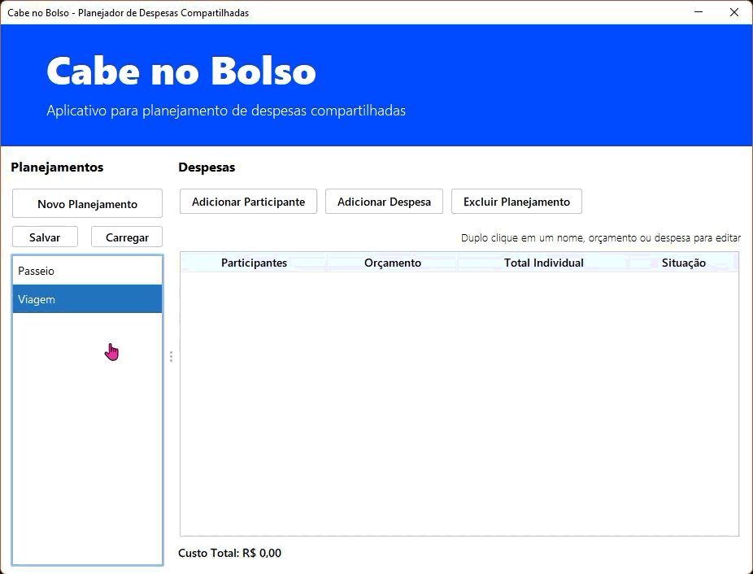

# Planejador de Despesas Compartilhadas
<div> 


</div>

## 📑️ Índice
* [Descrição do Projeto](#️-descrição-do-projeto)
* [Organização das Pastas](#️-organização-das-pastas)
* [Técnicas e Tecnologias Utilizadas](#️-técnicas-e-tecnologias-utilizadas)
* [Funcionalidades e Demonstração da Aplicação](#️-funcionalidades-e-demonstração-da-aplicação)
* [Como Baixar o Projeto](#️-como-baixar-o-projeto)
* [Como Executar o Projeto](#️-como-executar-o-projeto)

## 📝️ Descrição do projeto
Aplicação Java para planejar despesas compartilhadas. 

O programa foi desenvolvido para a atividade final da disciplina Programação Orientada a Objetos.

## 🗂️ Organização das pastas
```
planejador-de-despesas-compartilhadas/
│
├── src/
│   └── main/
│       └── java/
│             ├── controller/
│             │   └── PlanejamentoController.java
│             ├── model/
│             │   ├── Participante.java
│             │   ├── Despesa.java
│             │   ├── DespesaFixa.java
│             │   ├── DespesaPorPessoa.java
│             │   ├── Planejamento.java
│             │   ├── RepositorioArquivo.java
│             │   └── RepositorioPlanejamento.java
│             │
│             ├── view/
│             │   ├── ModalNovaDespesa.form
│             │   ├── ModalNovaDespesa.java
│             │   ├── ModalNovoParticipante.form
│             │   ├── ModalNovoParticipante.java
│             │   ├── ModalNovoPlanejamento.form
│             │   ├── ModalNovoPlanejamento.java
│             │   ├── TelaPrincipal.form
│             │   └── TelaPrincipal.java
│             │
│             └── PlanejadorDeDespesasCompartilhadas.java
├── README.md
└── pom.xml
```
## ☑️ Técnicas e Tecnologias Utilizadas
- `Java 27`
- `Java Swing`
- `NetBeans IDE GUI Builder`
- `Maven`

## 💻️ Funcionalidades e Demonstração da Aplicação

Com a aplicação é possível fazer planejamentos de atividades em grupos e fazer a organização de despesas de cada participante.


### Funcionalidades: 
- Cadastrar múltiplos planejamentos;
- Adicionar participantes em um planejamento;
- Adicionar despesas ao planejamento que são vinculadas aos participantes selecionados;
- Após adicionar despesas, é exibido o valor que cada participante deve pagar, a situação em relação ao orçamento do participante e o custo total do planejamento;
- Editar o nome e orçamento de um participante, e apagar despesas de um planejamento. Além disso, é possível excluir um planejamento por completo;




## ⬇️ Como Baixar o Projeto
1. Você pode baixar o projeto clicando no botão `Code` que se encontra mais acima nessa página, e clique em `Download ZIP`;
2. Após baixar o projeto para o seu computador, extraia o arquivo ZIP;


## ⚙️ Como Executar o Projeto
1. Para isso você deve ter instalado no seu computador o Java Runtime Environment (JRE) ou Java Development Kit (JDK);
2. Abra o terminal de seu computador e estando no caminho onde o projeto se encontra no computador, digite ` java -jar PlanejadorDespesasCompartilhadas.java ` e aperte Enter.

> Obs: Você também pode executar o projeto por meio de uma IDE, como Eclipse, NetBeans, IntelliJ IDEA e outras.